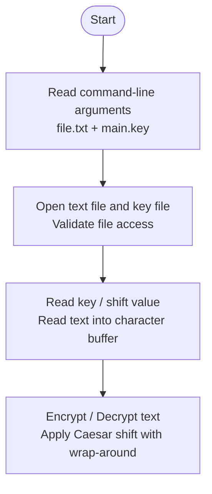

# CeaserCLI — Text Encryption & Decryption Tool

[](https://en.wikipedia.org/wiki/C99)
[](https://www.jiit.ac.in/)
[](https://www.jiit.ac.in/)
[](#-license)

[](https://www.jiit.ac.in/)
[](#-team-members)
[](#)


| Name | Enrollment / Roll No. | Role / Module Contribution |
| :--- | :---: | :--- |
| **Chetan Sharma** | `992601030398` | Architecture, File I/O & Key Handling |
| **Agrim Rastogi** | `992601030401` | Caesar Cipher Algorithm Implementation |
| **Priyansh Joshi** | `992601030391` | CLI Interface, Argument Parsing & Validation |
| **Mohd. Shaan** | `992601030392` | Error Handling, Test Cases & Documentation |

---

## 📑 Table of Contents

- [I. Introduction](#-i-introduction)
- [II. Problem Statement](#-ii-problem-statement)
- [III. Project Objectives](#-iii-project-objectives)
- [IV. Proposed Methodology & Mathematical Foundation](#-iv-proposed-methodology--mathematical-foundation)
- [V. C Concepts Applied in the Project](#-v-c-concepts-applied-in-the-project)
- [VI. System & Functional Requirements](#-vi-system--functional-requirements)
- [VII. System Architecture & Control Flow](#-vii-system-architecture--control-flow)
- [VIII. Project Structure](#-viii-project-structure)
- [IX. How to Build & Run](#-ix-how-to-build--run)
  - [Prerequisites](#prerequisites)
  - [Compilation](#compilation)
- [X. Command-Line Usage & Examples](#-x-command-line-usage--examples)
  - [Command Syntax](#command-syntax)
  - [Key File Specification](#key-file-specification)
  - [Step-by-Step Walkthrough](#step-by-step-walkthrough)
- [XI. Expected Outcomes](#-xi-expected-outcomes)
- [XII. Limitations & Future Scope](#-xii-limitations--future-scope)
- [XIII. Conclusion](#-xiii-conclusion)
- [XIV. References](#-xiv-references)

---

## 1. Introduction
The proposed project implements a Text Encryption and Decryption Tool developed in C. It will use the Caesar Cipher encryption algorithm. The tool will read text from a user-specified file and use a key stored in a separate key file to perform encryption or decryption.

---

## 2. Problem Statement
Plain text stored in files is directly readable by anyone who can access it. The project aims to develop a simple program that processes a text file using a key provided through a separate key file. The file and key file will be supplied to the program through command-line arguments.


## 3. Objectives
- To implement the Caesar Cipher in C for encryption and decryption of text stored in a file.
- To accept command-line arguments for user interaction.
- To demonstrate the use of arrays, structures, and pointers.
- To use file handling for reading and writing data.

## 4. Proposed Methodology
The program will receive two command-line arguments: the path of the text file and the path of the key file. For example, the program may be invoked as:

```bash
./a.out file.txt main.key
```

The key file will contain the key/shift value used by the Caesar Cipher.

The program will open the input text file, read its contents into a character buffer, and obtain the key from the key file. During processing, the program will traverse the character data and shift alphabetic characters. Encryption will shift characters forward, whereas decryption will apply the reverse shift.

### Shift Key $k = 3$:

| Operation | Input Character | Alphabet Index | Formula Applied | Shifted Index | Output Character |
| :--- | :---: | :---: | :---: | :---: | :---: |
| **Encrypt** | `'H'` | 7 | $(7 + 3) \bmod 26$ | 10 | `'K'` |
| **Encrypt** | `'E'` | 4 | $(4 + 3) \bmod 26$ | 7 | `'H'` |
| **Encrypt** | `'L'` | 11 | $(11 + 3) \bmod 26$ | 14 | `'O'` |
| **Encrypt** | `'O'` | 14 | $(14 + 3) \bmod 26$ | 17 | `'R'` |
| **Decrypt** | `'K'` | 10 | $(10 - 3 + 26) \bmod 26$ | 7 | `'H'` |

$$\text{Plaintext: } \texttt{"HELLO WORLD!"} \xrightarrow{\text{Shift } k=3} \text{Ciphertext: } \texttt{"KHOOR ZRUOG!"}$$


## 5. System and Functional Requirements

- The program shall accept the input text file path as a command-line argument.
- The program shall accept the key file path as a command-line argument.
- The program shall provide encryption and decryption operations using the supplied key.
- The program shall read and process the contents of the input file.
- The program shall handle invalid arguments and file-access errors appropriately; the implementation shall use arrays, structures, pointers and file handling.

### Public Key and Private Key
- **Public Key**: A binary file containing a sequence of shift values (1–25). It is used during encryption.
- **Private Key**: A binary file containing the inverse shift values calculated as `(26 - shift) % 26`. It is used during decryption.

This key pair allows data encrypted with the public key to be correctly restored only with the matching private key.

---

## VII. Design / Control Flow

The planned control flow begins by validating the two command-line arguments, opening the input text file and key file, reading the key, processing the text using the Caesar Cipher, and completing the selected encryption/decryption operation. The flow also includes validation and file-error handling.



## VIII. Expected Outcomes

The completed project is expected to provide a working console-based application that reads text from a file and uses a separately supplied key file to perform Caesar Cipher encryption and decryption. It will demonstrate practical use of character arrays, structures, pointers, functions, file handling, loops and conditional statements while implementing a simple text transformation algorithm.

The project will also provide a clear understanding of the relationship between an algorithm, command-line arguments, files, key management, data representation and program control flow in a C application.

## IX. Limitations and Future Scope

The Caesar cipher is a basic classical encryption technique and should not be considered secure for protecting sensitive or confidential information. It is not cryptographically secure.

The project can be extended in future by adding other encryption techniques, a graphical user interface, or stronger modern cryptographic algorithms.

## X. Conclusion

The Text Encryption and Decryption Tool provides a compact practical application of the Caesar Cipher while demonstrating fundamental C programming concepts. By combining arrays, structures, pointers, functions, file handling and control flow, the project connects core programming concepts with a simple file-based text transformation use case.

## XI. References

1. B. W. Kernighan and D. M. Ritchie, *The C Programming Language*, 2nd ed. Prentice Hall, 1988.
2. B. Schneier, *Applied Cryptography: Protocols, Algorithms, and Source Code in C*, 2nd ed. John Wiley & Sons, 1996.
3. Course material and laboratory notes for SDF–1, Department of Computer Science and Engineering, JIIT Noida.

---

## Build and Run

**Requirements:** GCC or Clang.

**Compile**

```bash
gcc main.c cipher.c -o a.out
```

**Run**

```bash
echo "HELLO WORLD" > file.txt
echo "3" > main.key
./a.out file.txt main.key
```
