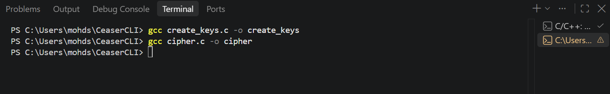
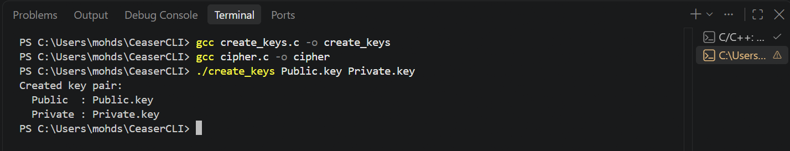
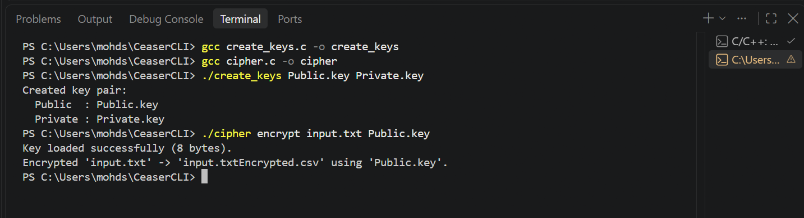
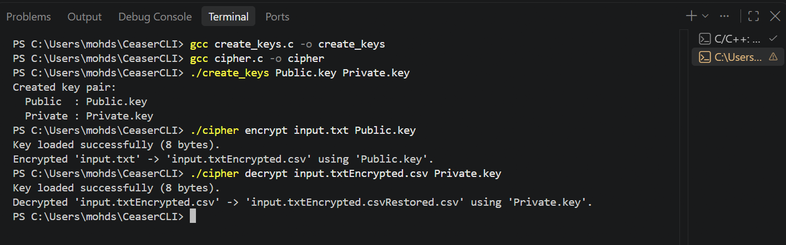

# Text Encryption and Decryption Tool

## Table of Contents
1. Introduction  
2. Problem Statement  
3. Objectives  
4. Proposed Methodology  
5. System and Functional Requirements  
6. Design and Implementation  
7. Usage  
8. Screenshots  
9. Limitations and Future Scope  
10. Conclusion  
11. References  

---

## 1. Introduction
This project implements a file-based encryption and decryption tool developed in C. It uses a multi-shift Caesar cipher approach to transform the contents of a text file using a public key and restore the original content using a corresponding private key.

## 2. Problem Statement
Plain text stored in files can be easily read by anyone who has access to it. This project aims to provide a simple mechanism to encrypt the contents of a file and decrypt it back to its original form using a key pair.

## 3. Objectives
- To implement encryption and decryption of text files in C.
- To demonstrate the use of arrays, structures, and pointers.
- To use file handling for reading and writing data.
- To apply a multi-shift Caesar cipher using binary key files.

## 4. Proposed Methodology
The program accepts command-line arguments for the operation mode (encrypt/decrypt), the input file, and the key file.

- The public key contains a sequence of shift values.
- The private key contains the corresponding inverse shifts.
- Only alphabetic characters are modified during encryption and decryption.
- Non-alphabetic characters remain unchanged.

## 5. System and Functional Requirements

### Functional Requirements
- The program shall accept command-line arguments for mode, input file, and key file.
- The program shall encrypt alphabetic characters using the public key.
- The program shall decrypt the data using the private key.
- Non-alphabetic characters shall remain unchanged.
- The program shall generate an output file after processing.

### Public Key and Private Key
- **Public Key**: A binary file containing a sequence of shift values (ranging from 1 to 25). It is used during the encryption process.
- **Private Key**: A binary file containing the inverse shift values, calculated as `(26 - shift) % 26`. It is used during decryption.

Data encrypted using the public key can only be correctly restored using the matching private key.

## 6. Design and Implementation
The project demonstrates the following C programming concepts:

- **Structures**: Used to group related configuration data such as file names, key information, and operation mode.
- **Arrays**: Used to store the sequence of shift values read from the key file.
- **Pointers**: Used to pass structures and modify character data efficiently.
- **File Handling**: Used to read the input file and binary key file, and to write the processed output.

## 7. Usage

### Compilation
```bash
gcc create_keys.c -o create_keys
gcc cipher.c -o cipher

### Generate Keys
./create_keys Public.key Private.key

### Encrypt a File
./cipher encrypt input.txt Public.key

### Decrypt a File
./cipher decrypt input.txtEncrypted.txt Private.key

8. Screenshots
Compilation


Key Generation


Encryption


Decryption


9. Limitations and Future Scope
The current implementation uses a classical multi-shift Caesar cipher, which is not suitable for protecting highly sensitive information.
Future improvements may include support for stronger encryption algorithms and improved handling of larger files.

10. Conclusion
This project successfully demonstrates the practical application of arrays, structures, pointers, and file handling in C through a functional encryption and decryption system.

11. References
1.Kernighan, B. W., & Ritchie, D. M. (1988). The C Programming Language (2nd ed.).
2.Course material – SDF-1, Department of Computer Science and Engineering, JIIT Noida.