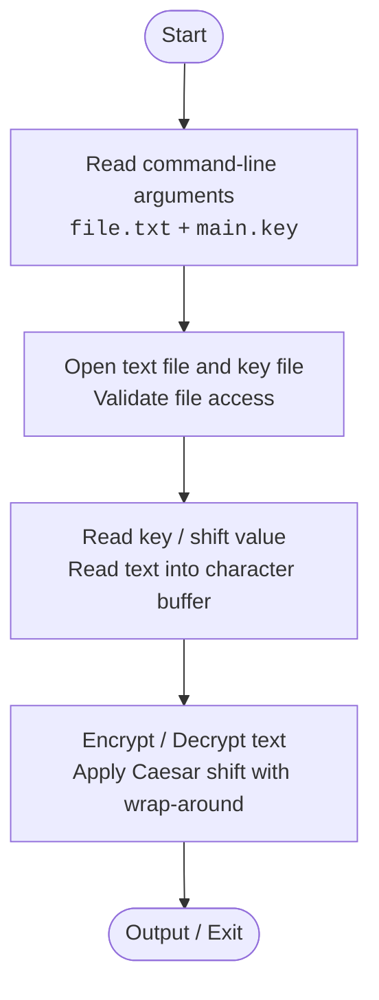

# Text Encryption & Decryption Tool

> **Course:** Software Development Fundamentals – 1 (SDF–1)  
> **Department:** Department of Computer Science and Engineering, JIIT Noida  
> **Batch:** F21  
> **Faculty / Instructor:** Dr. Shariq Murtuza  

---

## 👥 Team Members

| Name | Roll Number / Enrollment |
| :--- | :--- |
| **Chetan Sharma** | 992601030398 |
| **Agrim Rastogi** | 992601030401 |
| **Priyansh Joshi** | 992601030391 |
| **Mohd. Shaan** | 992601030392 |

---

## 📖 I. Introduction

The **Text Encryption & Decryption Tool** is a command-line interface application developed in **C**. It utilizes the classical **Caesar Cipher** encryption algorithm to process text. The tool reads text from a user-specified input file and uses an integer shift key stored in an external key file to perform character-level encryption or decryption.

---

## ❗ II. Problem Statement

Plain text stored in files is directly accessible and legible to anyone with file system access. This project aims to address basic confidentiality by developing a simple program that processes a text file using a key supplied via a separate key file. Both the target text file and the key file are supplied to the program through command-line arguments.

---

## 🎯 III. Objectives

- To implement the **Caesar Cipher algorithm in C** for encryption and decryption of text stored in a file.
- To accept and process **command-line arguments** for user interaction and file path inputs.
- To practice and demonstrate core C concepts including file I/O, dynamic memory/buffers, pointers, structures, and control flow.

---

## ⚙️ IV. Proposed Methodology

The program receives two command-line arguments:
1. Path to the text file (`file.txt`)
2. Path to the key file (`main.key`)

```bash
./a.out file.txt main.key
```

### Operation Pipeline:
1. **File Ingestion:** The program opens the input text file and reads its content into a character buffer.
2. **Key Extraction:** It opens the key file and retrieves the integer key / shift value used by the Caesar Cipher.
3. **Transformation:** The program traverses the character buffer and applies shift transformations on alphabetic characters:
   - **Encryption:** Shifts alphabetic characters forward by the key value with modulo wrap-around (`(c - base + shift) % 26 + base`).
   - **Decryption:** Applies the reverse shift (`(c - base - shift + 26) % 26 + base`).
   - Non-alphabetic characters (digits, spaces, punctuation) are preserved.

### Example (Shift = 3):
$$\text{Encryption: } \texttt{HELLO} \longrightarrow \texttt{KHOOR}$$
$$\text{Decryption: } \texttt{KHOOR} \longrightarrow \texttt{HELLO}$$

---

## 🧱 C Concepts Applied in the Project

| C Concept | Use in the Project / Application |
| :--- | :--- |
| **Arrays** | Character arrays/buffers store text read from the input file so the program can process the data one character at a time. |
| **Structures** | A structure groups encryption-related settings such as the key and processing information into one logical unit. |
| **Pointers** | Pointers are used to access/pass character buffers and work with file data, demonstrating direct memory-based data access. |
| **Control Flow** | `if/else` statements, loops, and argument checks control file processing, character transformation, wrap-around, and program execution. |
| **Functions** | Separate user-defined functions handle file operations, key reading, encryption/decryption, and validation, keeping the program modular. |
| **File Handling** | File handling is a core part of the project: the program reads the input text from a file and obtains the encryption/decryption key from a separate key file. |

---

## 📋 VI. System and Functional Requirements

- **Command-Line Arguments:**
  - The program shall accept the input text file path as a command-line argument.
  - The program shall accept the key file path as a command-line argument.
- **Core Operations:**
  - The program shall provide encryption and decryption operations using the supplied key.
  - The program shall read and process the contents of the input file.
- **Error Handling & Architecture:**
  - The program shall handle invalid arguments (e.g., incorrect argument count) and file-access errors (e.g., missing or inaccessible files) gracefully.
  - The implementation shall modularly use arrays, structures, pointers, and standard C file handling.

---

## 🔄 VII. Design / Control Flow



---

## 🏆 VIII. Expected Outcomes

- A working console-based C application that reads text from a file and uses a separately supplied key file to perform Caesar Cipher encryption and decryption.
- Practical demonstration and mastery of fundamental C programming concepts:
  - Character arrays & buffers
  - Structures
  - Pointers and memory manipulation
  - Modular functions
  - Standard file handling (`fopen`, `fscanf`, `fgets`/`fread`, `fclose`)
  - Loops and conditional branches
- A clear understanding of the interaction between algorithmic processing, command-line interfaces, file storage, key management, and program control flow in C.

---

## ⚠️ IX. Limitations and Future Scope

### Limitations
- The Caesar cipher is a basic classical substitution cipher and **should not be considered secure** for protecting sensitive or confidential information in modern computing. It is vulnerable to frequency analysis and brute-force attacks (only 25 possible keys).

### Future Scope
- **Modern Cryptography:** Extension to support modern cryptographic standards (e.g., AES, RSA, DES) or polyalphabetic ciphers (e.g., Vigenère).
- **User Interface:** Adding a Graphical User Interface (GUI) or an interactive TUI.
- **Enhanced CLI Options:** Flags for specifying operation modes (`-e` for encrypt, `-d` for decrypt), custom output destination files (`-o output.txt`), and in-place file transformation.

---

## 📌 X. Conclusion

The **Text Encryption & Decryption Tool** provides a compact practical application of the Caesar Cipher while demonstrating fundamental C programming concepts. By combining arrays, structures, pointers, functions, file handling, and control flow, the project bridges theoretical programming concepts with a real-world, file-based text processing use case.

---

## 📚 XI. References

1. **B. W. Kernighan and D. M. Ritchie**, *The C Programming Language*, 2nd ed. Prentice Hall, 1988.
2. **B. Schneier**, *Applied Cryptography: Protocols, Algorithms, and Source Code in C*, 2nd ed. John Wiley & Sons, 1996.
3. *Course material and laboratory notes for SDF–1*, Department of Computer Science and Engineering, JIIT Noida.

---

## 🚀 How to Build & Run

### Prerequisites
- GCC or Clang compiler
- Make (optional)

### Compilation
Compile the project using `gcc`:
```bash
gcc -Wall -Wextra main.c cipher.c -o a.out
```

### Execution Example
1. Prepare your input file and key file:
   ```bash
   echo "HELLO WORLD" > file.txt
   echo "3" > main.key
   ```
2. Run the application:
   ```bash
   ./a.out file.txt main.key
   ```
