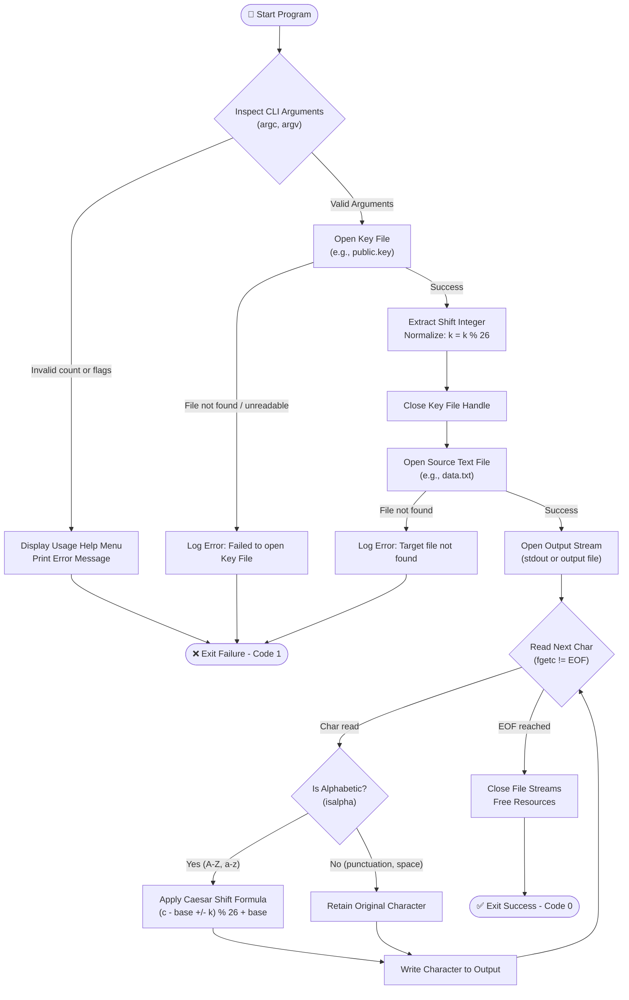

# CeaserCLI — Text Encryption & Decryption Tool

[](https://en.wikipedia.org/wiki/C99)
[](https://www.jiit.ac.in/)
[](https://www.jiit.ac.in/)
[](#-license)

[](https://www.jiit.ac.in/)
[](#-team-members)
[](#)

---

## 👥 Team Members

| Name | Enrollment / Roll No. | Role / Module Contribution |
| :--- | :---: | :--- |
| **Chetan Sharma** | `992601030398` | Architecture, File I/O & Key Handling |
| **Agrim Rastogi** | `992601030401` | Caesar Cipher Algorithm Implementation |
| **Priyansh Joshi** | `992601030391` | CLI Interface, Argument Parsing & Validation |
| **Mohd. Shaan** | `992601030392` | Error Handling, Test Cases & Documentation |

---

## 📑 Table of Contents

- [I. Introduction](#-i-introduction)
- [II. Problem Statement](#-ii-problem-statement)
- [III. Project Objectives](#-iii-project-objectives)
- [IV. Proposed Methodology & Mathematical Foundation](#-iv-proposed-methodology--mathematical-foundation)
- [V. C Concepts Applied in the Project](#-v-c-concepts-applied-in-the-project)
- [VI. System & Functional Requirements](#-vi-system--functional-requirements)
- [VII. System Architecture & Control Flow](#-vii-system-architecture--control-flow)
- [VIII. Project Structure](#-viii-project-structure)
- [IX. How to Build & Run](#-ix-how-to-build--run)
  - [Prerequisites](#prerequisites)
  - [Compilation](#compilation)
- [X. Command-Line Usage & Examples](#-x-command-line-usage--examples)
  - [Command Syntax](#command-syntax)
  - [Key File Specification](#key-file-specification)
  - [Step-by-Step Walkthrough](#step-by-step-walkthrough)
- [XI. Expected Outcomes](#-xi-expected-outcomes)
- [XII. Limitations & Future Scope](#-xii-limitations--future-scope)
- [XIII. Conclusion](#-xiii-conclusion)
- [XIV. References](#-xiv-references)

---

## 📖 I. Introduction

The **Text Encryption & Decryption Tool (`CeaserCLI`)** is a command-line interface application implemented in **standard C (C99)**. It applies the classical **Caesar Cipher** cryptographic substitution algorithm to encrypt and decrypt arbitrary text files.

Designed as an academic project for **Software Development Fundamentals – 1 (SDF–1)** at **JIIT Noida**, the tool reads raw text from a target input file, extracts a numeric shift key from a standalone key file, applies modular character transformations, and produces secure ciphertext or recovered plaintext. It bridges core computer science theory with low-level systems programming in C.

---

## ❗ II. Problem Statement

Plaintext files stored on file systems are immediately readable by any user, process, or unauthorized party with read permissions. While modern security relies on complex cryptographic algorithms, understanding foundational encryption mechanisms is critical for systems developers.

This project addresses fundamental confidentiality by developing a robust command-line utility in C that:
1. Ingests a plaintext file and an external key file via command-line arguments.
2. Encrypts the source text using an integer shift substitution to prevent direct readability.
3. Provides a deterministic decryption routine to reconstruct the original plaintext using the corresponding key.
4. Enforces strict input validation and file-level error handling.

---

## 🎯 III. Project Objectives

- **Implement Classical Cryptography in C:** Build an accurate, reversible Caesar Cipher algorithm supporting uppercase, lowercase, punctuation, whitespace, and newline preservation.
- **Master Command-Line Argument Processing:** Parse and validate `argc` and `argv` for dynamic execution paths (operation type, target files, key paths).
- **Apply Fundamental C Concepts:** Demonstrate practical mastery of:
  - File Streams & Handling (`fopen`, `fgetc`, `fscanf`, `fprintf`, `fclose`)
  - Dynamic Memory Allocation & Static Character Buffers
  - Pointers & Address-based Buffer Transformations
  - Pure, Basic C Design (direct, lightweight approach without complex abstractions or structs)
  - Modular Code Organization (`.h` header interfaces and `.c` implementations)
- **Robust Error Handling:** Detect and gracefully report file I/O failures, missing arguments, invalid key formats, and memory boundaries.

---

## ⚙️ IV. Proposed Methodology & Mathematical Foundation

### Mathematical Formulation of Caesar Cipher

The Caesar Cipher is a monoalphabetic substitution cipher where each letter in the plaintext is shifted by a fixed number of positions $k$ down the alphabet.

Let the alphabet size be $m = 26$, and let each character $x \in \{0, 1, \dots, 25\}$ represent its alphabetical index ($A/a = 0, B/b = 1, \dots, Z/z = 25$):

#### 1. Encryption Function:
$$E_k(x) = (x + k) \pmod{26}$$

#### 2. Decryption Function:
$$D_k(x) = (x - k) \pmod{26}$$

In C integer arithmetic, the modulo operator `%` can yield negative results for negative dividends. Decryption is therefore safely implemented using standard wrap-around arithmetic:
$$D_k(x) = (x - (k \bmod 26) + 26) \pmod{26}$$

### Character Class Rules:
- **Uppercase Letters (`A`–`Z`):** Normalized with base `'A'` (`ASCII 65`), shifted modulo 26, then restored to `'A'`.
- **Lowercase Letters (`a`–`z`):** Normalized with base `'a'` (`ASCII 97`), shifted modulo 26, then restored to `'a'`.
- **Non-Alphabetic Characters:** Digits, punctuation (`.`, `,`, `!`), spaces (` `), and newlines (`\n`) remain unchanged to maintain document layout.

### Visual Example (Shift Key $k = 3$):

| Operation | Input Character | Alphabet Index | Formula Applied | Shifted Index | Output Character |
| :--- | :---: | :---: | :---: | :---: | :---: |
| **Encrypt** | `'H'` | 7 | $(7 + 3) \bmod 26$ | 10 | `'K'` |
| **Encrypt** | `'E'` | 4 | $(4 + 3) \bmod 26$ | 7 | `'H'` |
| **Encrypt** | `'L'` | 11 | $(11 + 3) \bmod 26$ | 14 | `'O'` |
| **Encrypt** | `'O'` | 14 | $(14 + 3) \bmod 26$ | 17 | `'R'` |
| **Decrypt** | `'K'` | 10 | $(10 - 3 + 26) \bmod 26$ | 7 | `'H'` |

$$\text{Plaintext: } \texttt{"HELLO WORLD!"} \xrightarrow{\text{Shift } k=3} \text{Ciphertext: } \texttt{"KHOOR ZRUOG!"}$$

---

## 🧱 V. C Concepts Applied in the Project

The implementation leverages key topics covered in the **SDF–1** syllabus:

| C Concept | Concrete Use in `CeaserCLI` | Technical Detail |
| :--- | :--- | :--- |
| **Arrays & Buffers** | Character arrays store chunked text, line data, and file paths. | Pre-allocated text buffers (`char buffer[BUFFER_SIZE]`) hold streamed file data for character-by-character processing. |
| **Pointers** | Direct pointer access and passing buffers/variables by reference. | Pointers (`char *`, `int *shift`, `FILE *fp`) pass shift values and file handles cleanly without structs. |
| **Control Flow** | Validation logic, loops, and boundary checks. | `if`/`else` trees validate CLI arguments; `while ((ch = fgetc(fp)) != EOF)` streams input; ternary operators normalize character cases. |
| **Modular Functions** | Separation of concerns across compilation units. | Independent functions for key parsing (`read_key`), transformation (`caesar_encrypt`, `caesar_decrypt`), and file streaming (`process_file`). |
| **File Handling (I/O)** | Persistent input ingestion and output writing. | Employs `fopen()`, `fgetc()`, `fscanf()`, `fputs()`, and `fclose()` with strict file pointer null checks (`NULL`) and `perror()` logging. |

---

## 📋 VI. System & Functional Requirements

### 1. Functional Requirements
- **FR-01 (CLI Argument Parsing):** Program must accept input file path, key file path, and operation mode (`encrypt` / `decrypt` or `-e` / `-d`).
- **FR-02 (External Key Ingestion):** Program must read an integer shift value from a dedicated key file (e.g., `main.key`, `publicShaan.key`).
- **FR-03 (Modular Shift Normalization):** Any integer key (including negative values or shifts $> 26$) must be normalized into the valid range $[0, 25]$ using $k_{\text{eff}} = ((k \bmod 26) + 26) \bmod 26$.
- **FR-04 (Format Preservation):** Non-alphabetic symbols, line breaks, tabs, and spaces must remain byte-identical.
- **FR-05 (Reversibility):** Decrypting ciphertext with the original key must produce a bit-for-bit match of the original plaintext.

### 2. Non-Functional & Safety Requirements
- **NFR-01 (Error Handling):** Invalid argument count must display usage instructions and exit with non-zero status.
- **NFR-02 (Resource Management):** Every opened `FILE*` handle must be closed cleanly via `fclose()`, preventing file descriptor leaks.
- **NFR-03 (Portability):** Strict adherence to ANSI C / C99 ensures seamless compilation across macOS, Linux, and Windows (MinGW/MSVC).

---

## 🔄 VII. System Architecture & Control Flow

### Execution Pipeline



---

## 📂 VIII. Project Structure

```bash
CeaserCLI/
├── README.md                 # Complete project documentation & synopsis
├── SDF_PROJ_SYPNOSIS.pdf     # Official SDF-1 project synopsis submission
├── main.c                    # Application entry point, CLI parser & interactive menu
├── cipher.h                  # Header interface and function prototypes (basic C, no structs)
├── cipher.c                  # Core Caesar algorithm and file processing logic
├── data.txt                  # Sample input plaintext file for testing
├── publicShaan.key           # Sample public encryption key file (shift value)
├── privateChetan.key         # Sample private decryption key file
└── .gitignore                # Git exclusions (build artifacts, executables)
```

---

## 🚀 IX. How to Build & Run

### Prerequisites
- **C Compiler:** `gcc` or `clang`

### Compilation

Compile the project directly with `gcc`:
```bash
gcc *.c -o CeaserCLI
```

Or with standard warnings:
```bash
gcc -Wall -Wextra *.c -o CeaserCLI
```

---

## 💻 X. Command-Line Usage & Examples

### Mode 1: Interactive Menu (When run with no arguments `argc < 2`)

Simply execute `./CeaserCLI` without any parameters to enter interactive menu mode:

```bash
./CeaserCLI
```

```text
===================================
    Caesar Cipher - Main Menu      
===================================
1. Encrypt a file
2. Decrypt a file
3. Exit
Enter your choice (1-3): 1
Enter input file name: data.txt
Enter key file name: publicShaan.key
Enter output file name (or enter '-' to print on screen): encrypted.txt

Processing...
Operation successful! Output written to: encrypted.txt
```

---

### Mode 2: Direct Command-Line Arguments (`argc == 4` or `5`)

```bash
# Standard Command Syntax:
./CeaserCLI <mode: encrypt|decrypt> <input_file> <key_file> [output_file]

# Or with short flags:
./CeaserCLI -e <input_file> <key_file> [output_file]    # Encrypt
./CeaserCLI -d <input_file> <key_file> [output_file]    # Decrypt
```

> [!NOTE]
> If `[output_file]` is omitted in CLI mode, the transformed text is displayed directly on standard output (`stdout`).

---

### Key File Specification

Key files contain an integer value representing the rotational shift:

```bash
# Create an encryption key with shift = 3
echo "3" > publicShaan.key

# Create a decryption key with shift = 3
echo "3" > privateChetan.key
```

---

### Step-by-Step Walkthrough

#### 1. Prepare Test Data
Create a sample plaintext file:
```bash
echo "Software Development Fundamentals (SDF-1) - JIIT 2026!" > data.txt
```

#### 2. Encrypt the File
Run `CeaserCLI` in encryption mode:
```bash
./CeaserCLI encrypt data.txt publicShaan.key encrypted.txt
```

Verify the encrypted content:
```bash
cat encrypted.txt
# Output:
# Vriwzduh Ghyhorsphqw Xqgdphqwdo (VGI-1) - MLLW 2026!
```

#### 3. Decrypt the File
Run `CeaserCLI` in decryption mode using the corresponding key:
```bash
./CeaserCLI decrypt encrypted.txt privateChetan.key decrypted.txt
```

#### 4. Validate Integrity
Verify that the decrypted output matches the original input:
```bash
diff -s data.txt decrypted.txt
# Output:
# Files data.txt and decrypted.txt are identical
```

---

## 🏆 XI. Expected Outcomes

- **Operational Console Utility:** A reliable, compiled binary capable of encrypting and decrypting arbitrary text files without corruption.
- **Academic Synthesis:** Comprehensive synthesis of theoretical algorithms with core low-level C programming principles (memory, streams, data layout).
- **Graceful Fault Tolerance:** Clear diagnostic messages when facing missing arguments, nonexistent files, or malformed numeric keys.

---

## ⚠️ XII. Limitations & Future Scope

### Limitations
- **Cryptographic Strength:** The Caesar cipher offers a keyspace of only 25 unique non-trivial shifts. It is vulnerable to frequency analysis and brute-force key exhaustion attacks. It is strictly meant for educational and demonstrative purposes.
- **Binary Data:** The algorithm is tailored for ASCII text; binary streams (such as compiled executables or images) contain arbitrary byte values that require polyalphabetic or block-based ciphers.

### Future Scope
- **Polyalphabetic Ciphers:** Extend the engine to support the **Vigenère Cipher** or **XOR One-Time Pad** for enhanced confusion and diffusion.
- **Modern Cryptography Integration:** Implement standard symmetric cryptographic algorithms like **AES-128 / AES-256** using OpenSSL or custom C routines.
- **Interactive TUI / GUI:** Develop an interactive terminal dashboard using `ncurses` or a graphical desktop client.
- **In-Place File Mode:** Add an `--in-place` flag to overwrite the source file with its ciphered counterpart directly.

---

## 📌 XIII. Conclusion

The **Text Encryption & Decryption Tool (`CeaserCLI`)** demonstrates the intersection between classical cryptographic concepts and foundational C software development. By leveraging modular functions, structured data types, pointers, and robust file streaming, the project fulfills all academic and functional requirements established by the **Department of Computer Science & Engineering, JIIT Noida** for **SDF–1**.

---

## 📚 XIV. References

1. **B. W. Kernighan and D. M. Ritchie**, *The C Programming Language*, 2nd ed., Englewood Cliffs, NJ: Prentice Hall, 1988.
2. **B. Schneier**, *Applied Cryptography: Protocols, Algorithms, and Source Code in C*, 2nd ed., New York, NY: John Wiley & Sons, 1996.
3. **W. Stallings**, *Cryptography and Network Security: Principles and Practice*, 7th ed., Pearson, 2017.
4. *Course Material and Laboratory Guidelines for Software Development Fundamentals – 1 (SDF–1)*, Department of Computer Science and Engineering, Jaypee Institute of Information Technology (JIIT), Noida.

---

## 📄 License

This project is developed solely for academic coursework and educational purposes under the **SDF–1** curriculum at **JIIT Noida**. All rights reserved by the project team.
