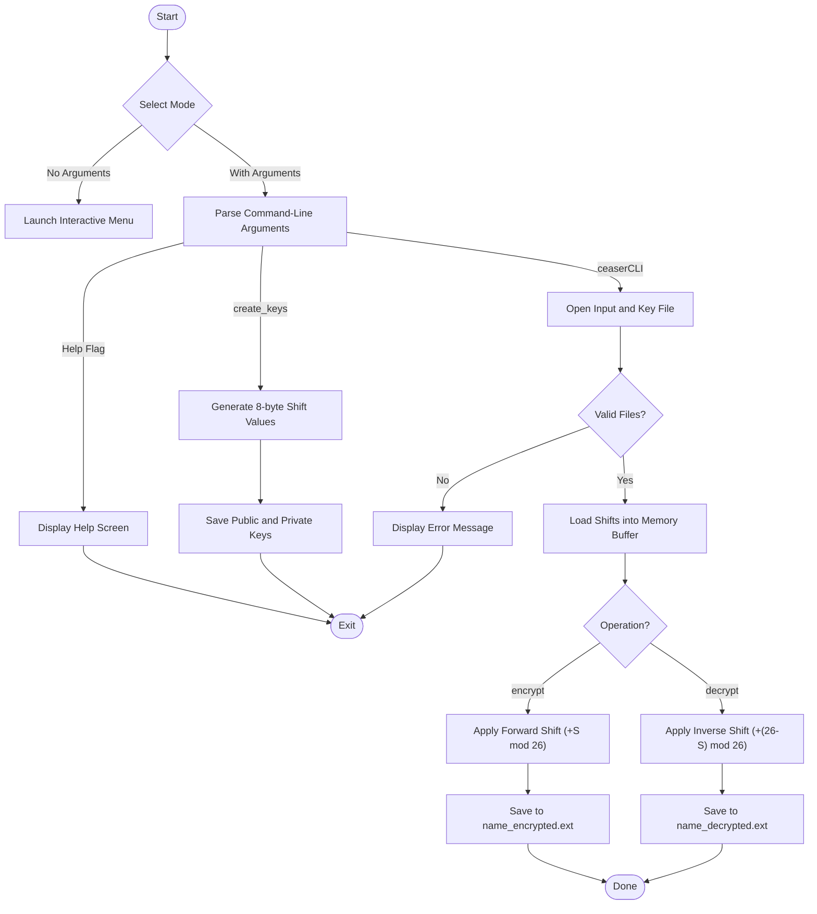
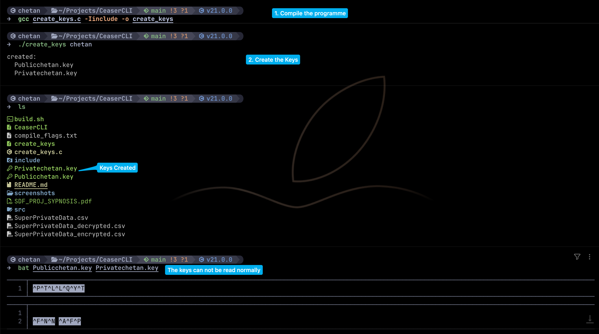
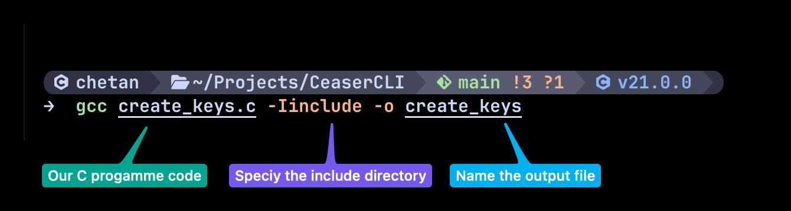
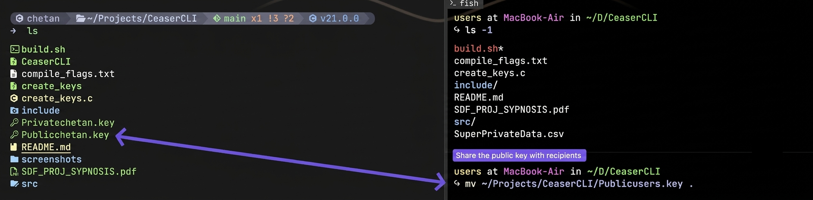
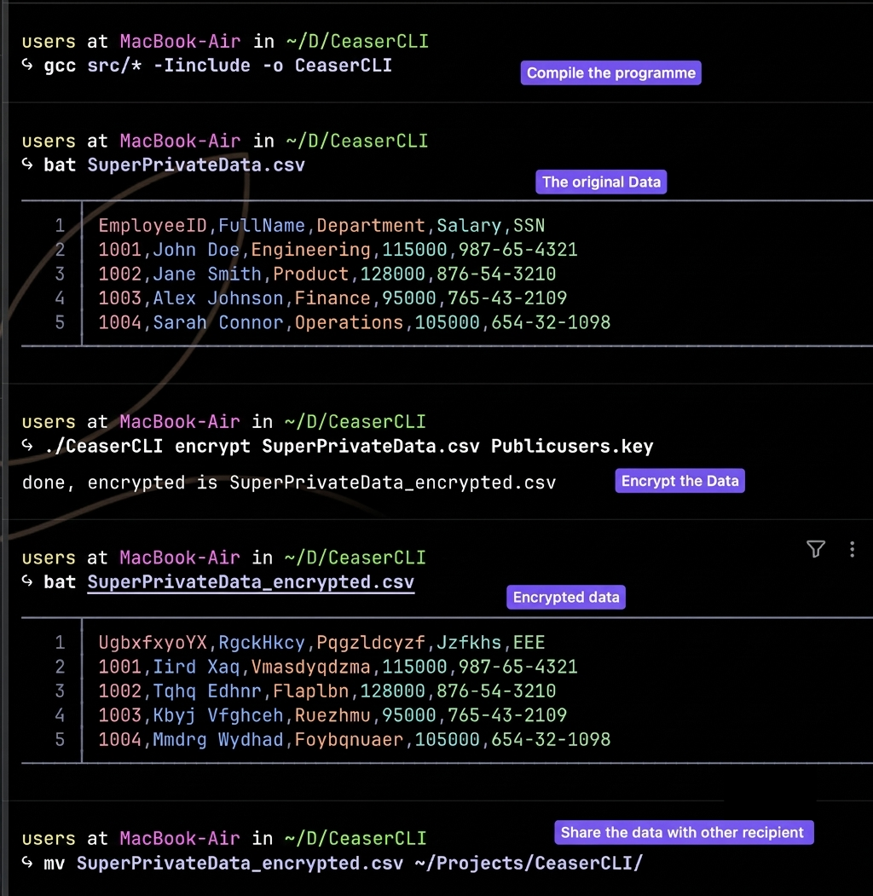
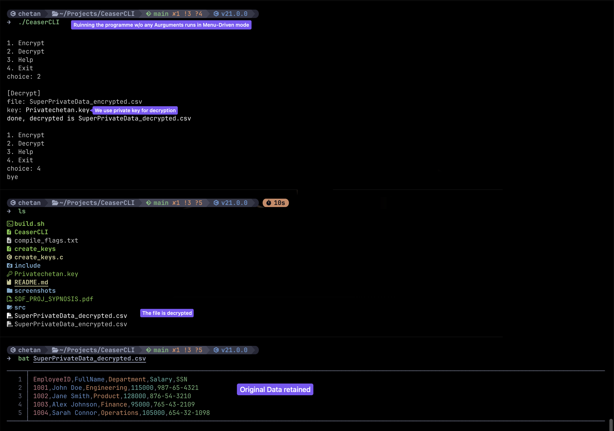

# CeaserCLI : Text Encryption and Decryption Tool

**Course:** Software Development Fundamentals – 1  
**Batch:** F21  
**Instructor:** Dr. Shariq Murtuza  

---

## Team

| Name | Roll Number |
| :--- | :--- |
| Chetan Sharma | 992601030398 |
| Agrim Rastogi | 992601030401 |
| Priyansh Joshi | 992601030391 |
| Mohd. Shaan | 992601030392 |

---

## Table of Contents
1. [Introduction](#1-introduction)  
2. [Problem Statement](#2-problem-statement)  
3. [Objectives](#3-objectives)  
4. [Proposed Methodology](#4-proposed-methodology)  
5. [System and Functional Requirements](#5-system-and-functional-requirements)  
6. [Design and Implementation](#6-design-and-implementation)  
7. [Usage and Compilation](#7-usage-and-compilation)  
8. [Screenshots](#8-screenshots)  
9. [Limitations and Future Scope](#9-limitations-and-future-scope)  
10. [Conclusion](#10-conclusion)  
11. [References](#11-references)  

---

## 1. Introduction
This project implements a file-based encryption and decryption tool developed in C. It uses the Caesar cipher approach to transform the contents of target file using a public key and restore the original content using the corresponding private key.

The tool provides two modes of interaction: a fast, scriptable command-line interface (CLI) for direct terminal execution, and a menu-driven console interface for interactive use.

---

## 2. Problem Statement
Plain text files are easily readible by anyone. CeaserCLI is a tool that scrambles the file's contents so it isn’t readable at a glance, and gets the exact original back later using a matching key.

---

## 3. Objectives
- Implement file-based Caesar Cipher encryption and decryption of files.
- Design an independent key generation utility producing paired public/private shift sequences.
- Offer dual-interface flexibility: direct CLI argument processing and an interactive console menu.

---

## 4. Proposed Methodology

### 4.1 Key Generation Mechanism
The key generator creates two paired 8-byte binary files:
- **Public Key (`Public<Name>.key`):** Contains random shift values $S_i \in [1, 25]$ for each character position.
- **Private Key (`Private<Name>.key`):** Contains the modular inverse shift values:
  $$S'_i = (26 - S_i) \pmod{26}$$

Because $(S_i + S'_i) \equiv 0 \pmod{26}$, any text shifted forward by $S_i$ is fully restored by applying $S'_i$.

### 4.2 Stream Transformation Algorithm
The cipher processes files character-by-character:
1. **Alphabetic Characters:** Case is preserved (uppercase stays uppercase, lowercase stays lowercase), and the active shift $S_i$ is applied with circular modulo wrap-around:
   $$\text{Encryption: } C = (P - \text{base} + S_i) \pmod{26} + \text{base}$$
   $$\text{Decryption: } P = (C - \text{base} + S'_i) \pmod{26} + \text{base}$$
2. **Key Cycling:** The shift index cycles across the 8-byte key buffer using $(count \pmod{8})$.

```
Example Transformation (Single Shift = 3):
Original:   HELLO -> KHOOR
Restored:   KHOOR -> HELLO
```

---

## 5. System and Functional Requirements

- **Command-Line & Menu Interfaces:** The unified program automatically opens the interactive menu when executed without arguments, or directly processes CLI commands (`encrypt`, `decrypt`, `--help`) when arguments are supplied.
- **Independent Key Pair Utility:** A standalone utility (`create_keys`) generates binary key files.
- **Input & File Validation:** Check for file existence, non-empty paths, and verify key files before attempting transformations.

---

## 6. Design and Implementation

### 6.1 C Programming Concepts Demonstrated
- **Header Files:** The header file [`include/cipher.h`](include/cipher.h) holds the `Cfg` struct and function prototypes.
- **Structure:** Configuration states (input path, key path, output path, shift buffer, mode) are encapsulated in the `Cfg` struct.
- **Arrays & Memory Buffers:** Binary key sequences and string paths are stored in fixed-size buffers.
- **Pointers:** Memory addresses are passed to functions for in-place character transformations and struct manipulation.
- **File I/O:** Stream reading and writing via standard file pointers (`fopen`, `fgetc`, `fputc`, `fread`, `fwrite`, `fclose`).
- **Modular arithmetic:** `count % 8` picks the shift and `% 26` warps letters around the alphabet.

### 6.2 Control Flow Diagram



---

## 7. Usage and Compilation

### 7.1 Compilation

Compile the CeaserCLI programme using :-
```bash
bash ./build.sh
```
If you are on MacOS/Linux

Or directly with `gcc`:
```bash
gcc src/cipher.c src/ceaserCLI.c -Iinclude -o ceaserCLI
```

---

### 7.2 Key Generator (`create_keys`)
`create_keys.c` is the key-pair generator for CeaserCLI
```bash
gcc create_keys.c -o create_keys

# Generate key pair with `Chetan` suffix
./create_keys Chetan

# OR generate default key pair (Public.key & Private.key)
./create_keys
```

---

### 7.3 CeaserCLI

The application decides what to do based on arguments:
- **No arguments (`./ceaserCLI`)**: Launches the interactive menu. 
- **Arguments (`./ceaserCLI <encrypt|decrypt> <file> <key>`)**: Runs the operation directly.
- **Invalid arguments / `--help`**: Displays the help menu.

```bash
# 1. Interactive Menu Mode (no arguments)
./ceaserCLI

# 2. File Encryption
./ceaserCLI encrypt input.csv PublicChetan.key
# Output: done, encrypted is input_encrypted.csv

# 3. File Decryption
./ceaserCLI decrypt input_encrypted.csv PrivateChetan.key
# Output: done, decrypted is input_decrypted.csv

# 4. Display Help
./ceaserCLI --help
```

---

## 8. Screenshots

### 8.1 Key Pair Generation Demo (`create_keys`)


---

### 8.2 Key File Structure & Byte Breakdown


---

### 8.3 Sharing the Public Key


---

### 8.4 File Encryption via CLI


---

### 8.5 File Decryption & Data Restoration


---

## 9. Limitations and Future Scope

- Ceaser cipher is weak and can be cracked by brute force alone, with only 8 repeating shifts frequency analysis can break it.
- Use stronger keys, cryptographically strong algorithms like AES.
- Support encrypting whole folders.

---

## 10. Conclusion

We built a working command-line tool in C that encrypts a file and file and restores it back using only the matching key. 

---

## 11. References

1. B. W. Kernighan and D. M. Ritchie, *The C Programming Language*, 2nd ed. Prentice Hall, 1988.
2. B. Schneier, *Applied Cryptography: Protocols, Algorithms, and Source Code in C*, 2nd ed. John Wiley & Sons, 1996.
3. Course material and laboratory notes for SDF–1, Department of Computer Science and Engineering, JIIT Noida.
